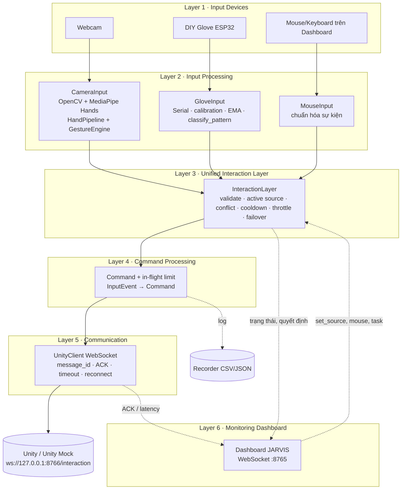
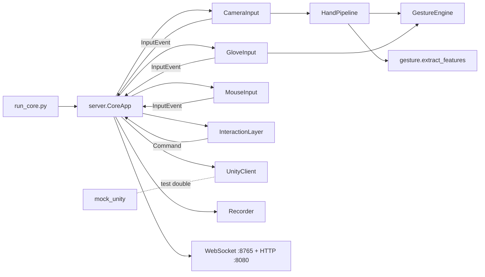
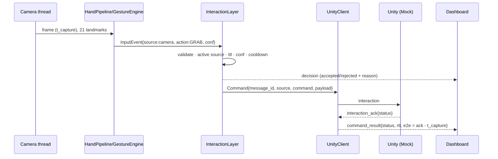
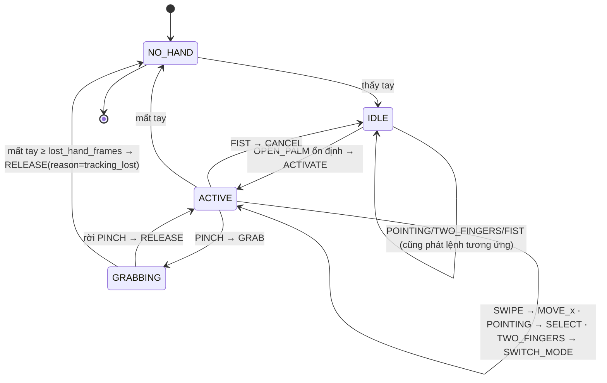

# KINEVERSE AI Interaction Core – Kiến trúc & thiết kế

Phạm vi: chỉ AI Interaction Core cho **Pha 2** (Camera AI + găng tay + chuột → lệnh thống nhất → Unity). Không có scene Unity, kéo thả 3D, vật lý, snap-to-grid hay Hologram Pyramid.

Sơ đồ dùng Mermaid (xem được trên GitHub, VS Code với extension Mermaid, hoặc https://mermaid.live).

## 1. System Architecture (6 lớp)



## 2. Component Diagram


Giao diện mở rộng: `InputDevice` (`inputs/base.py`). Thêm thiết bị = lớp mới phát `InputEvent` qua `sink.emit()`. Đổi giao thức Unity = thay `UnityClient` (cùng hàm `send_command(cmd) -> AckResult`).

## 3. Data Flow



## 4. Gesture State Machine

Trạng thái bàn tay: `NO_HAND → IDLE → ACTIVE ⇄ GRABBING`. Cử chỉ tĩnh phải ổn định `stable_frames` khung liên tiếp; lệnh chỉ phát khi *chuyển* cử chỉ (edge-triggered) và có cooldown theo lệnh.



| Gesture | Cách nhận diện | Lệnh |
|---|---|---|
| OPEN_PALM | 4 ngón trỏ→út duỗi (tỷ lệ \|đầu ngón–cổ tay\| / \|khớp gốc–cổ tay\|) | ACTIVATE |
| PINCH | \|ngón cái–ngón trỏ\| / kích thước bàn tay < `pinch_on` (hysteresis `pinch_off`), trỏ không gập | GRAB (rời pinch → RELEASE) |
| SWIPE L/R/U/D | lúc OPEN_PALM: dịch chuyển lòng bàn tay ≥ `swipe_min_dist` trong `swipe_window_s`, tốc độ ≥ `swipe_min_speed`, hướng chủ đạo | MOVE_LEFT/RIGHT/UP/DOWN |
| TWO_FINGERS | chỉ trỏ + giữa duỗi | SWITCH_MODE |
| FIST | cả 4 ngón gập | CANCEL |
| POINTING | chỉ trỏ duỗi | SELECT |
| UNKNOWN | confidence < `min_confidence` hoặc tư thế không khớp | (không phát lệnh) |

Thêm cử chỉ mới: (1) thêm nhánh trong `extract_features`, (2) thêm vào `STATIC_TO_ACTION`, (3) thêm action vào `events.ACTIONS`.

## 5. Unified Interaction Layer

Mọi nguồn → cùng `InputEvent` → cùng `Command`; Unity không biết nguồn nào (trường `source` chỉ để log).

| Cơ chế | Hiện thực |
|---|---|
| Active source | 1 nguồn hoạt động; sự kiện nguồn khác bị loại (`inactive_source`) → chống xung đột |
| Đổi nguồn | nút/phím 1-2-3; từ chối nếu thiết bị chưa kết nối |
| Failover | nguồn đang dùng mất kết nối > `source_timeout_s` → chuyển theo `priority` |
| Validation | source/action hợp lệ, confidence ∈ [0,1], payload là dict, event_id không trùng |
| Lọc | `stale` (quá `event_ttl_s`), `low_confidence`, `cooldown`, `throttled` (MOVE/ROTATE/SCALE) |
| An toàn | RELEASE/CANCEL/RESET không bị cooldown; mất tay khi đang GRAB → tự RELEASE |
| Hàng đợi | tối đa `max_in_flight` lệnh chờ ACK; vượt → bỏ & đếm `dropped_commands` |
| Lỗi | ACK / FAILED / TIMEOUT / NOT_CONNECTED đều hiển thị và ghi log |

## 6. Dashboard (JARVIS HUD)

Màu: nền `#050B14`, cyan `#00D9FF`, blue `#1677FF`, cam `#FF8A00`, OK `#00E5A8`, cảnh báo `#FFC247`, lỗi `#FF4D6D`. Font monospace cho nhãn kỹ thuật. Không có thư viện ngoài, chạy offline.

```
┌ HEADER: KINEVERSE AI CORE │ CORE ● │ UNITY ✓ │ FPS │ E2E ms │ clock ─────────────┐
│ CONTROL SOURCE  │  INTERACTION VIEW (camera + landmarks + radar    │ GESTURE      │
│ ① CAMERA AI     │  + scan line + hiệu ứng ring/sweep/banner)       │ RECOGNITION  │
│ ② SENSOR GLOVE  │                                                  │ gesture/conf │
│ ③ MOUSE CONTROL │  ┌ ARC CORE ┐ ┌ SIM OBJECT (placeholder 2D) ┐    │ command/event│
│ UNITY LINK      │  └──────────┘ └─────────────────────────────┘    │ EVENT LOG    │
│ PERFORMANCE     │                                                  │              │
├ EXPERIMENT: task start/ok/fail · retry · misread · export · bảng tóm tắt ───────────┤
```
Hiệu ứng: pinch → vòng xác nhận + "OBJECT SELECTED"; swipe → quét theo hướng + mũi tên + tên lệnh; đổi nguồn → banner `CAMERA → GLOVE`; ACK/lỗi → Arc Core nháy xanh/đỏ. Khi dữ liệu giả lập: banner vàng **DEMO MODE** và dấu `*` ở log.

## 7. Độ trễ

`e2e_ms = thời điểm nhận ACK − thời điểm chụp khung hình` (cùng đồng hồ `perf_counter`). Với Unity Mock, số này **không** gồm thời gian Unity render. Phải đo lại với Unity thật; mục tiêu < 500 ms chưa được kiểm chứng.

